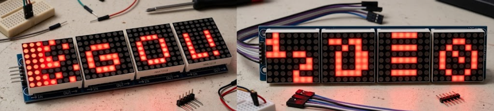
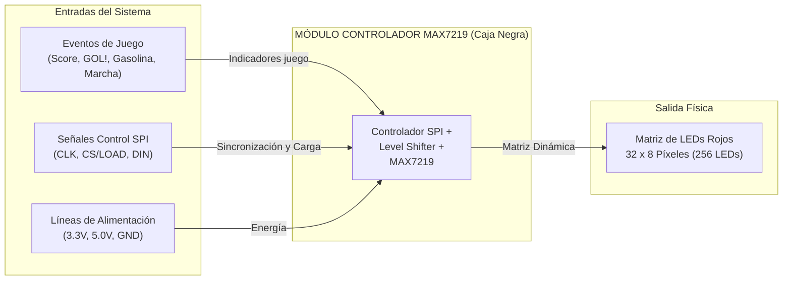
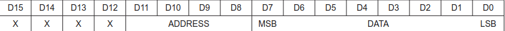
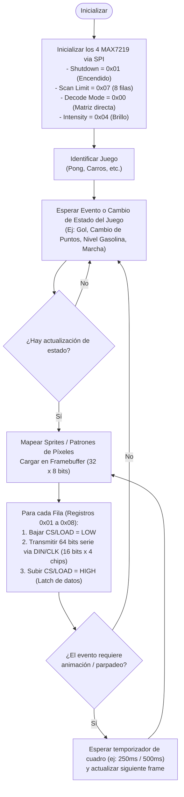

# Comunicación serie con MAX7219 para una matriz de LEDs

Este documento explica la implementacion de una pantalla auxiliar a la consola de videojuegos. Incluye diagramas, cableado, el formato de los comandos, la inicialización, ejemplos e implementacion.

> **Alcance:** el MAX7219 emplea una interfaz serie síncrona de tres señales, compatible con una configuración SPI habitual. No dispone de lectura MISO. Las posiciones visibles dependen de la orientación y el cableado del módulo; conviene comprobarlas con un patrón de prueba.
>
> 

## Índice

1. [Introducción y Especificaciones](#1-Introducción-y-Especificaciones-del-Hardware)
2. [Diagrama de Caja Negra e Interfaz de Señales](#2-Diagrama-de-Caja-Negra-e-Interfaz-de-Señales)
3. [Temporización](#3-Temporización)
4. [Cuatro módulos en cascada](#4-cuatro-módulos-en-cascada)
5. [Inicialización](#5-inicialización)
6. [Mostrar eventos](#6-Mostrar-evntos-de-juego)
7. [Ejemplo de implementación](#7-ejemplo-de-implementación)
8. [Comprobaciones y límites](#8-comprobaciones-y-límites)


# 1. Introducción y Especificaciones del Hardware

Este sistema de visualización está diseñado para mostrar información dinámica y telemetría de juegos en tiempo real (marcador y animaciones de "GOL!" en Pong, barras de combustible y estado en juegos de carreras). La pantalla consiste en **cuatro módulos de matriz LED de 8 × 8 encadenados en cascada** (resolución total de 32 × 8 píxeles, monocromática en color rojo), controlados centralmente por el circuito integrado **MAX7219** mediante un bus serie síncrono.

## Ficha Técnica del Módulo

| Parámetro | Especificación | Observaciones |
| --- | --- | --- |
| **Configuración de Píxeles** | 32 × 8 LEDs (256 puntos) | 4 matrices de 8 × 8 cátodo común en cascada. |
| **Color de Emisión** | Rojo monocromático | Longitud de onda típica ≈ 620–630 nm. |
| **Controlador de Display** | MAX7219 (1 por matriz de 8 × 8) | Maneja el multiplexado dinámico por hardware. |
| **Tensión de Alimentación ($V_{CC}$)** | 5.0 V DC | Requerido por el chip MAX7219 para brillo nominal. |
| **Nivel Lógico de Entrada ($V_{IH}$)** | Mínimo 3.5 V | Requiere adaptación desde FPGA de 3.3 V. |
| **Consumo Máximo de Corriente** | ≈ 320 mA – 1 A | Varía según intensidad y porcentaje de píxeles encendidos. |
| **Interfaz de Comunicación** | Serie síncrona tipo SPI (3 hilos) | `DIN`, `CLK`, `CS/LOAD`. |


| Señal del controlador | Pin del primer MAX7219 | Función |
| --- | --- | --- |
| `MOSI` | `DIN` | Datos de entrada, bit más significativo primero. |
| `SCK` | `CLK` | Reloj; el chip toma `DIN` en el flanco ascendente. |
| GPIO de salida | `CS` / `LOAD` | En bajo se desplazan bits; el flanco ascendente carga los registros. |
| Alimentación | `VCC`, `GND` | Alimentación y tierra común según el módulo utilizado. |

`DOUT` del primer chip se conecta a `DIN` del siguiente. `CLK` y `CS/LOAD` se distribuyen a todos los chips. No se conecta `MISO` porque el MAX7219 no devuelve datos. Comprueba los niveles lógicos admitidos por tu placa y el módulo: un controlador de 3,3 V no debe suponerse compatible con una entrada alimentada a 5 V sin revisar sus especificaciones.

> **Nota sobre niveles de voltaje (3.3V vs 5V)**
>
> * **Conflicto de Voltajes:** Los pines de I/O de la FPGA operan con lógica de 3.3V LVCMOS, mientras que el controlador MAX7219 se alimenta a 5V.
> * **Umbral de Reconocimiento:** El MAX7219 requiere un voltaje de entrada alto ($V_{IH}$) de al menos **3.5V** para garantizar la lectura de un `'1'` lógico. Enviar señales directamente a 3.3V desde la FPGA puede provocar instabilidad, pérdida de datos o pantallas que no responden.
> * **Solución:** Se debe conectar un **Conversor de Niveles Lógicos (Logic Level Shifter)** en las líneas unidireccionales del bus SPI (`DIN`, `CLK` y `CS/LOAD`) para elevar las señales de 3.3V a 5V. 

---

# 2. Diagrama de Caja Negra e Interfaz de Señales


El controlador (FPGA) actúa como maestro del bus SPI. Dado que la lógica del controlador opera a 3.3 V (LVCMOS) y los módulos MAX7219 requieren un umbral de alto de al menos 3.5 V cuando se alimentan con 5.0 V, las señales se canalizan a través de un **conversor de niveles lógicos (Logic Level Shifter)**.

El sistema de visualización se abstrae como un módulo de control donde la lógica del juego y las señales de alimentación entran al controlador, el cual procesa la información y la proyecta en la matriz física de $32 \times 8$ LEDs.



## Interfaz y Conexión de Señales

| Señal Controlador | Pin Shifter (IN) | Pin Shifter (OUT) | Pin Primer MAX7219 | Dirección | Función y Descripción |
| --- | --- | --- | --- | --- | --- |
| `MOSI` | `A1` (3.3 V) | `B1` (5.0 V) | `DIN` | Entrada | Datos serie enviados bit a bit, MSB primero. |
| `SCK` | `A2` (3.3 V) | `B2` (5.0 V) | `CLK` | Entrada | Reloj serie. Captura `DIN` en flanco de subida. |
| `GPIO_CS` | `A3` (3.3 V) | `B3` (5.0 V) | `CS` / `LOAD` | Entrada | Habilita carga. En alto transfiere el registro al display. |
| `+3.3V` | `VCCA` | -- | -- | Alimentación | Referencia lógica del lado del controlador. |
| `+5.0V` | `VCCB` | -- | `VCC` | Alimentación | Alimentación principal de los MAX7219 y matriz de LEDs. |
| `GND` | `GND` | `GND` | `GND` | Salida/Ref | Tierra común de todo el sistema. |

> **Nota sobre el Adaptador de Nivel Lógico (Level Shifter):**
> * **Incompatibilidad de Voltajes:** La lógica FPGA opera a 3.3 V LVCMOS. La especificación eléctrica del fabricante para el MAX7219 exige un voltaje de entrada alto ($V_{IH}$) mínimo de 3.5 V a $V_{CC} = 5.0\text{ V}$.
> * **Riesgo:** Conectar las líneas SPI directamente a 3.3 V puede resultar en comportamientos erráticos, pérdida de tramas de datos o falla total del encendido de los LEDs.
> * **Solución Implementada:** Se coloca un convertidor bidireccional/unidireccional de nivel lógico de alta velocidad en las líneas `DIN`, `CLK` y `CS/LOAD`.


# 3. Temporización

El cronograma se incluye en la [lámina general de la cascada](#4-cuatro-módulos-en-cascada).

1. Poner `CS/LOAD` en bajo.
2. Estabilizar cada bit en `DIN` antes del **flanco ascendente** de `CLK`; transmitir primero el bit más significativo.
3. Enviar 16 pulsos por chip (64 pulsos para cuatro chips).
4. Llevar `CS/LOAD` a alto **después de transmitir el último bit**. En ese flanco, cada chip carga su palabra de 16 bits.

**Particularidad del MAX7219:** el registro de desplazamiento toma datos con los flancos ascendentes de `CLK` incluso cuando `LOAD` está alto. `LOAD` no bloquea el reloj como un selector SPI convencional; su flanco ascendente transfiere la palabra recibida al registro indicado. Por ello, hay que completar los 64 bits de la cadena antes de cada carga y considerar este comportamiento si se comparte el bus.

Una configuración SPI habitual es **modo 0** (`CPOL=0`, `CPHA=0`), MSB primero. Ajusta frecuencia y tiempos de establecimiento, retención y pulso de `LOAD` a la hoja de datos del chip y a las condiciones de tu cableado. La figura es conceptual y no está a escala.

## Comando de 16 bits y registros



| Bits | Contenido |
| --- | --- |
| `D15–D12` | Sin uso (*don't care*); normalmente se envían como `0000`. |
| `D11–D8` | Dirección de registro (4 bits). |
| `D7–D0` | Dato de 8 bits. |

Por comodidad se envían **dos bytes**: primero la dirección `0x0R`, después el dato `0xVV`. Por ejemplo, `0x01 0xA0` escribe `10100000₂` en el registro de dígito 1. Los registros 1 a 8 controlan las ocho posiciones de barrido; con `decode mode = 0`, cada bit del dato enciende o apaga un LED de esa posición. Según el módulo, esa posición puede verse como fila o columna.

| Dirección | Registro | Uso |
| --- | --- | --- |
| `0x00` | No-op | Mantiene sin cambios ese chip durante una transferencia en cascada. |
| `0x01`–`0x08` | Digit 0–7 | Ocho grupos de LEDs en modo sin decodificación. |
| `0x09` | Decode Mode | `0x00`: control directo de puntos. |
| `0x0A` | Intensity | Brillo `0x00`–`0x0F`. |
| `0x0B` | Scan Limit | `0x07`: ocho posiciones activas. |
| `0x0C` | Shutdown | `0x00`: apagado; `0x01`: funcionamiento normal. |
| `0x0F` | Display Test | `0x00`: prueba desactivada; `0x01`: todos los LED en prueba. |

## 4. Cuatro módulos en cascada


> **Cómo interpretar esta lámina:** la imagen adjunta reúne conexión, trama y temporización. Se conserva como vista general, con las siguientes correcciones técnicas que deben aplicarse al implementar el circuito:
>
> - **CLK es común a todos los chips.** Las flechas azules no representan una salida de reloj de un MAX7219 hacia otro. Solo los datos se encadenan mediante `DOUT → DIN`.
> - **Orden de envío:** en la numeración física de esta imagen, el chip #4 es el más cercano y el #1 el más alejado. Por tanto, se envía primero la palabra destinada al **#1**, luego **#2**, **#3** y finalmente **#4**. Los rótulos de destino de las tramas y del cronograma aparecen invertidos respecto a ese cableado.
> - **Dirección y datos se intercalan:** se envían cuatro parejas `[byte de dirección, byte de datos]`. No hay un bloque inicial de 32 bits de dirección seguido por 32 bits de datos, como podrían sugerir las flechas inferiores.
> - **Cada byte de dirección contiene cuatro bits sin uso y cuatro de dirección real**, detallados en la sección 3. En total hay 16 bits sin uso, 16 de dirección y 32 de datos.
> - El cronograma es conceptual: `DIN` debe estabilizarse antes de cada flanco ascendente y mantenerse el tiempo requerido después de este. Una transferencia completa contiene exactamente 64 pulsos.

La numeración #1–#4 de esta lámina es visual; el pseudocódigo utiliza índices **0–3, del más cercano al más alejado**.

Cada pulso desplaza un bit a través de los chips. Para actualizar un registro en los **cuatro módulos**, se transmiten **4 × 16 = 64 bits** con `CS/LOAD` en bajo y luego se genera **un único flanco ascendente**. La primera palabra enviada termina en el módulo **más alejado** del controlador; la última, en el más cercano.

Para dibujar una pantalla completa de 8 posiciones hacen falta **ocho transferencias de 64 bits** (512 bits), una por registro `0x01` a `0x08`. Así, los 64 bits actualizan una posición de los cuatro módulos, no toda la imagen de 32 × 8. Si solo cambia un módulo, se puede enviar `0x00 0x00` (*no-op*) a los otros tres dentro de la misma transferencia.


### Mapeo de Coordenadas y Framebuffer ($32 \times 8$)

La pantalla completa se representa como una matriz de 32 columnas por 8 filas ($X \in [0, 31], Y \in [0, 7]$). Para encender un píxel en la posición global $(X, Y)$, el controlador calcula su ubicación en la memoria mediante:

1. **Módulo Destino ($M$):** $M = \lfloor X / 8 \rfloor \quad (M \in \{0, 1, 2, 3\})$
2. **Bit Relativo ($b$):** $b = 7 - (X \bmod 8)$
3. **Registro / Fila ($R$):** $R = Y + 1 \quad (R \in \{0x01, \dots, 0x08\})$

El *Framebuffer* en la FPGA se organiza como una matriz de `buffer[8][4]` bytes (32 bytes totales), donde cada byte controla 8 píxeles horizontales de un módulo.


## 5. Inicialización

Tras encender el sistema, configura **cada chip**. Para ello, repite la misma palabra cuatro veces en cada transferencia de 64 bits:

| Orden sugerido | Dirección | Dato | Resultado |
| --- | --- | --- | --- |
| 0 | `0x0C` | `0x00` | Mantener apagada la pantalla durante la configuración. |
| 1 | `0x0F` | `0x00` | Desactivar prueba de pantalla. |
| 2 | `0x09` | `0x00` | Desactivar decodificación de caracteres. |
| 3 | `0x0B` | `0x07` | Barrer las ocho posiciones. |
| 4 | `0x0A` | `0x04` | Brillo inicial moderado; ajustar según el montaje. |
| 5 | `0x01`–`0x08` | `0x00` | Limpiar las ocho posiciones en los cuatro módulos. |
| 6 | `0x0C` | `0x01` | Salir del modo de apagado. |

## 6. Mostrar eventos de juego

Guarda el patrón de cada indicador como ocho grupos de cuatro bytes: `bitmap[posición][módulo]`. La correspondencia entre el índice de módulo y su ubicación visible se determina en la prueba de montaje.


La limpieza requiere escribir `0x00` en **los ocho registros de cada módulo**. Subir `LOAD` no borra ni alterna por sí solo los LED. Para evitar esperas bloqueantes, un sistema que atienda otras tareas puede alternar el bitmap y la pantalla vacía con un temporizador de 500 ms.

## 7. Ejemplo de implementación

Pseudocódigo independiente del microcontrolador. `spi_write` transmite un byte completo, MSB primero; el índice 0 representa el chip más cercano al controlador.

```text
función enviar_a_todos(registro, datos[4]):
    LOAD = BAJO
    para modulo desde 3 hasta 0:       // lejano → cercano
        spi_write(registro)
        spi_write(datos[modulo])
    LOAD = ALTO

función mostrar(bitmap[8][4]):
    para posicion desde 0 hasta 7:
        enviar_a_todos(posicion + 1, bitmap[posicion])

función limpiar():
    para posicion desde 1 hasta 8:
        enviar_a_todos(posicion, [0x00, 0x00, 0x00, 0x00])

función configurar(registro, dato):
    enviar_a_todos(registro, [dato, dato, dato, dato])
```

`LOAD` debe volver a bajo antes de la siguiente llamada. Si la librería SPI controla automáticamente el pin de selección por byte, configura `LOAD` como GPIO manual para mantenerlo bajo durante los ocho bytes completos de cada transferencia.

## 8. Comprobaciones y límites

- Verifica el orden físico de los cuatro módulos con un patrón distinto en cada uno; algunos paneles integrados presentan la imagen invertida o girada.
- Confirma que `DOUT → DIN`, `CLK`, `LOAD`, alimentación y tierra estén conectados como corresponde. Los cuatro módulos deben compartir tierra con el controlador.
- Una pantalla en blanco puede deberse a `Shutdown = 0`, `Scan Limit`, `Decode Mode`, `Display Test`, orden de bytes o al flanco de `LOAD`.
- El valor `0xA0` solo representa el patrón de bits de una posición; la orientación física de esos puntos depende de la placa.
- Dimensiona la fuente y el cableado para el consumo de los módulos y sus LED; ajusta la intensidad y la resistencia de configuración según la documentación del hardware.

## 9. Comandos 

La comunicacion con el MAX7219 se arma juntando la Dirección y el Valor:

Trama de 16 bits = [0000 (Relleno 4 bits)] + [Dirección del Comando (4 bits)] + [Valor / Configuración (8 bits / 1 byte)]

Viendolo en Hexadecimal (Recordando que cada dígito hex son 4 bits), la estructura es:

Trama Hex = 0x + 0 + Comando + Valor (2 dígitos)


## 9.1 Tabla de Registros y Comandos Principales

| Dirección Hex (`D11..D8`) | Nombre del Registro | Descripción Sencilla | Valores Típicos y Uso |
| :--- | :--- | :--- | :--- |
| `0x0` | **No-Op** | **Modo "Pasar de largo":** No hace ningún cambio. Se usa cuando hay varias pantallas conectadas en cadena para enviar datos a una pantalla lejana sin alterar las que están en medio. | `0x00` (Se usa cuando no se desea modificar la matriz actual). |
| `0x9` | **Decode Mode** | **Modo de Interpretación:** Define si el chip controla los LEDs uno por uno (modo gráfico) o si convierte números automáticamente para mostrarlos en displays de 7 segmentos. | `0x00` = Modo directo para matriz de LEDs 8x8.<br>`0xFF` = Modo automático para displays de 7 segmentos. |
| `0xA` | **Intensity** | **Control de Brillo:** Cambia la intensidad de la luz de los LEDs digitalmente sin necesidad de modificar componentes físicos en la tarjeta. | `0x00` = Brillo mínimo.<br>`0x07` = Brillo medio.<br>`0x0F` = Brillo máximo. |
| `0xB` | **Scan Limit** | **Cantidad de Filas Activas:** Indica cuántas filas de la pantalla se van a encender. En matrices de 8x8 debe configurarse siempre en 8 filas para evitar sobrecargar los LEDs. | `0x07` = Activa las 8 filas de la matriz (filas 0 a 7). |
| `0xC` | **Shutdown** | **Interruptor Apagado / Encendido:** Apaga la pantalla para ahorrar energía sin borrar el dibujo o texto guardado en la memoria. Al volver a encender, la imagen reaparece. | `0x00` = Pantalla apagada (modo ahorro).<br>`0x01` = Pantalla encendida (modo normal). |
| `0xF` | **Display Test** | **Prueba de Funcionamiento:** Enciende absolutamente todos los LEDs de la pantalla al mismo tiempo para comprobar si hay algún LED dañado o mal soldado. | `0x00` = Funcionamiento normal.<br>`0x01` = Modo de prueba (enciende todo). |


## 9.2. Ejemplos 

### Ejemplo 1: Cambio de Brillo
1. El comando de brillo es el registro `A` (en binario `1010`).
2. Para poner un brillo medio, por ejemplo nivel `7` (en binario `00000111`, en hex `07`).

👉 **Trama completa**
Se junta `0` + `A` + `07` = `0x0A07` (en binario: `0000 1010 0000 0111`).

### Ejemplo 2: Encender la pantalla (Salir de Shutdown)
1. El comando de Shutdown es el registro `C`.
2. Para encenderlo, el valor que exige el chip es un `1` (en hex `01`).

👉 **Trama completa**
Se junta `0` + `C` + `01` = `0x0C01` (en binario: `0000 1100 0000 0001`).

### Ejemplo 3: Poner píxeles en la Fila 1
1. La Fila 1 es la dirección `1`.
2. Se busca encender solo los LEDs del centro de esa fila, por ejemplo en binario `00111100` (que en hex es `3C`).

```text
Bit:    7   6   5   4   3   2   1   0
Valor:  0   0   1   1   1   1   0   0
LEDs:  [ ] [ ] [*] [*] [*] [*] [ ] [ ]
```

👉 **Trama completa**
Juntas `0` + `1` + `3C` = `0x013C` (en binario: `0000 0001 0011 1100`).


# Esta plantilla no es de mi propiedad.

Toda la documentación y diseño de esta plantilla se encuentra dentro del siguiente repositorio el cual **no me pertenece** y es propiedad del usuario [@cicamargo](https://github.com/cicamargoba).

[Github de digital_UN](https://github.com/cicamargoba/digital_UN/tree/main/2026_1)
