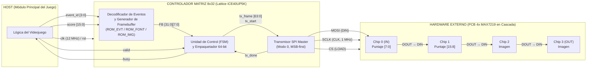
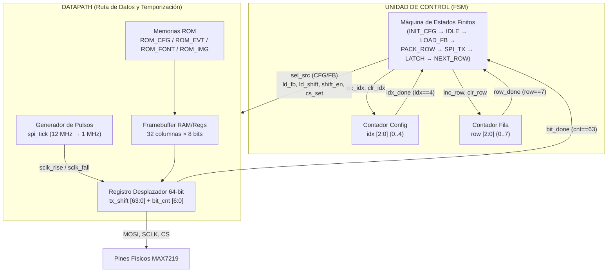
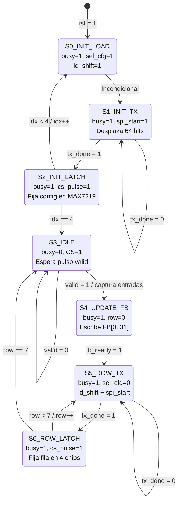

# Diseño-revisar

# Flujo CON ESTADOS

```mermaid
flowchart TD
    classDef inicio fill:#d1fae5,stroke:#059669,stroke-width:2px,color:#064e3b
    classDef bloque fill:#ffffff,stroke:#374151,stroke-width:1.5px,color:#111827
    classDef rombo fill:#fff3cd,stroke:#d97706,stroke-width:2px,color:#1f2937

    START(["INICIO (Reset FPGA)"]) --> INIT["S_RESET<br/>busy=1, CS=1<br/>idx=0, mode=SCORE"]

    %% ---------- Configuración ----------
    INIT --> CFG_LOAD["S_CFG_LOAD<br/>busy=1, CS=1<br/>tx_shift={4{ROM_CFG[idx]}}<br/>bit_cnt=63"]
    CFG_LOAD --> CFG_TX["S_CFG_TX<br/>busy=1, CS=0<br/>envía 64 bits por SPI"]
    CFG_TX --> CHK_SPI_CFG{"¿spi_done?<br/>(bit_cnt == 0)"}
    CHK_SPI_CFG -->|No| CFG_TX
    CHK_SPI_CFG -->|Sí| CFG_LATCH["S_CFG_LATCH<br/>busy=1, CS=1<br/>fija trama e idx++"]
    CFG_LATCH --> CHK_IDX{"¿idx == 5?"}
    CHK_IDX -->|No| CFG_LOAD
    CHK_IDX -->|Sí| BUILD_SCORE

    %% ---------- Armado del framebuffer ----------
    BUILD_SCORE["S_BUILD_SCORE<br/>busy=1, CS=1<br/>mode=SCORE<br/>FB ← dígitos de score_reg<br/>row=0"] --> ROW_PACK
    BUILD_EVENT["S_BUILD_EVENT<br/>busy=1, CS=1<br/>mode=EVENT<br/>FB ← ROM_IMG[img_id]<br/>timer=0, row=0"] --> ROW_PACK

    %% ---------- Refresco ----------
    ROW_PACK["S_ROW_PACK<br/>busy=1, CS=1<br/>arma 64 bits fila row+1<br/>bit_cnt=63"] --> ROW_TX
    ROW_TX["S_ROW_TX<br/>busy=1, CS=0<br/>envía 64 bits por SPI"]
    ROW_TX --> CHK_SPI_ROW{"¿spi_done?<br/>(bit_cnt == 0)"}
    CHK_SPI_ROW -->|No| ROW_TX
    CHK_SPI_ROW -->|Sí| ROW_LATCH
    ROW_LATCH["S_ROW_LATCH<br/>busy=1, CS=1<br/>fila visible en matriz"] --> CHK_ROW{"¿row == 7?"}

    CHK_ROW -->|No| INC_ROW["row = row + 1"] --> ROW_PACK
    CHK_ROW -->|Sí| CHK_MODE{"¿mode == EVENT?"}

    %% ---------- Visualización ----------
    CHK_MODE -->|No| SHOW_SCORE["S_SHOW_SCORE<br/>busy=0, CS=1<br/>muestra puntaje"]
    SHOW_SCORE --> CHK_VAL_SCORE{"¿valid == 1?"}
    CHK_VAL_SCORE -->|No| SHOW_SCORE
    CHK_VAL_SCORE -->|Sí| CAPTURE

    CHK_MODE -->|Sí| SHOW_EVENT["S_SHOW_EVENT<br/>busy=0, CS=1<br/>muestra evento, timer++ en tick"]
    SHOW_EVENT --> CHK_VAL_EVT{"¿valid == 1?"}
    CHK_VAL_EVT -->|Sí| CAPTURE
    CHK_VAL_EVT -->|No| CHK_TIMER{"¿timer == T_EVT?"}
    CHK_TIMER -->|No| SHOW_EVENT
    CHK_TIMER -->|Sí| BUILD_SCORE

    %% ---------- Captura ----------
    CAPTURE["S_CAPTURE<br/>busy=1, CS=1<br/>guarda score, event_id e img_id"] --> CHK_EVT{"¿event_id == 0?"}
    CHK_EVT -->|Sí| BUILD_SCORE
    CHK_EVT -->|No| BUILD_EVENT

    class START inicio
    class INIT,CFG_LOAD,CFG_TX,CFG_LATCH,BUILD_SCORE,BUILD_EVENT,ROW_PACK,ROW_TX,ROW_LATCH,INC_ROW,SHOW_SCORE,SHOW_EVENT,CAPTURE bloque
    class CHK_SPI_CFG,CHK_IDX,CHK_SPI_ROW,CHK_ROW,CHK_MODE,CHK_VAL_SCORE,CHK_VAL_EVT,CHK_TIMER,CHK_EVT rombo

```

## 1.1 Descripción General y Caja Negra- REVISARR

Se divide funcionalmente en dos mitades de **16 columnas** cada una (módulos numerados de `0` a `3` desde el puerto de entrada `IN` hacia `OUT`): YA NO

- **Módulos `0` y `1` (Columnas `0` a `15`):** Despliegan el **puntaje dinámico (`score`)** del jugador mediante caracteres almacenados en `ROM_FONT`.
- **Módulos `2` y `3` (Columnas `16` a `31`):** Despliegan **íconos o gráficos de estado (`16×8` píxeles)** almacenados en `ROM_IMG`, seleccionados según el evento ocurrido en el juego (`event_id`).

**Figura 1.** Diagrama de bloques general e interfaz de caja negra del controlador de matriz 8×32.

### Funcionamiento de la Interfaz (en orden)

1. El **Módulo Principal del Juego (Host)** entrega el identificador de evento (`event_id`), el puntaje actual (`score`) y activa el pulso `valid` cuando ocurre un cambio en el estado del juego.
2. El controlador verifica que no esté ocupado (`busy = 0`), captura las entradas y activa `busy = 1` mientras actualiza la memoria de video interna (*Framebuffer* `FB`) y transmite las tramas al bus SPI.
3. El **Decodificador** consulta `ROM_EVT[event_id]` para determinar la imagen `img_id` correspondiente, llena las columnas `0..15` del *Framebuffer* con los dígitos del puntaje (`ROM_FONT`) y las columnas `16..31` con el gráfico del evento (`ROM_IMG`).
4. El **Empaquetador de 64 bits** recorre las 8 filas (`row = 0..7`) y arma para cada fila una palabra de 64 bits compuesta por 4 paquetes de 16 bits (uno por cada MAX7219).
5. El **Transmisor SPI Master** envía los 64 bits en serie (`MOSI/DIN`) sincronizados con `SCLK` y genera un pulso en alto en `CS/LOAD` al finalizar cada trama de 64 bits para actualizar simultáneamente los 4 chips.

---

## 1.2 Arquitectura Interna del Núcleo (`matrix_8x32_core`)

El diseño se divide siguiendo una arquitectura **Controlador + Datapath** completamente síncrona bajo un único dominio de reloj (`clk = 12 MHz`):

**Figura 2.** Arquitectura interna del controlador: separación entre Unidad de Control y Datapath.

### Orden de Desplazamiento en Cascada (64 bits)

Dado que los 4 circuitos integrados MAX7219 están conectados en serie (`DOUT` del Chip `k` hacia `DIN` del Chip `k+1`), el primer paquete de 16 bits transmitido se desplaza hasta el último dispositivo de la cadena (`Chip 3`), mientras que el último paquete de 16 bits queda almacenado en el primer dispositivo (`Chip 0`). Por ello, el empaquetador ordena la trama de 64 bits de la siguiente manera:

$$
\text{Trama}_{64} =
\{
\underbrace{\text{Paquete}_{\text{Chip 3}}}_{[63:48]},
\underbrace{\text{Paquete}_{\text{Chip 2}}}_{[47:32]},
\underbrace{\text{Paquete}_{\text{Chip 1}}}_{[31:16]},
\underbrace{\text{Paquete}_{\text{Chip 0}}}_{[15:0]}
\}
$$

Cada paquete de 16 bits sigue el formato estándar del MAX7219:

$$
\text{Paquete}_{16} =
\{
\underbrace{4'\text{b0000}}_{\text{D15..D12 (Don't Care)}},
\underbrace{\text{ADDR}[3:0]}_{\text{D11..D8 (Registro)}},
\underbrace{\text{DATA}[7:0]}_{\text{D7..D0 (Dato)}}
\}
$$

### Tabla de Registros de Inicialización (`ROM_CFG`)

Al producirse un reinicio (`rst`), el controlador recorre las 5 posiciones (`idx = 0..4`) de `ROM_CFG`, replicando el mismo comando de 16 bits en los 4 chips de la cadena:

| Índice (`idx`) | Registro MAX7219 | Dirección (`ADDR`) | Valor (`DATA`) | Función en la Matriz 8×32 |
|:---:|:---|:---:|:---:|:---|
| `0` | **Display Test** | `0x0F` | `0x00` | Desactiva el modo de prueba (operación normal). |
| `1` | **Decode Mode** | `0x09` | `0x00` | Desactiva decodificación BCD; habilita control individual por LED (mapa de bits). |
| `2` | **Scan Limit** | `0x0B` | `0x07` | Habilita el barrido multiplexado de las 8 filas (`DIG0` a `DIG7`). |
| `3` | **Intensity** | `0x0A` | `0x04` | Fija brillo medio (`9/32` de ciclo útil) para limitar consumo de corriente. |
| `4` | **Shutdown** | `0x0C` | `0x01` | Saca los 4 chips del modo de bajo consumo y enciende la matriz. |

---

---

## 1.4 Diagrama de Estados Finitos (FSM)

La unidad de control se implementa mediante una FSM de **7 estados** con transiciones gobernadas por los eventos de sincronización del *Datapath* (`tx_done`, `idx == 4`, `row == 7`) y la señal `valid` del juego:

**Figura 4.** Diagrama de estados finitos (FSM) de la unidad de control.

### Descripción de Estados

1. **`S0_INIT_LOAD`:** Carga en el registro desplazador `tx_shift[63:0]` la palabra de configuración `ROM_CFG[idx]` replicada 4 veces.
2. **`S1_INIT_TX`:** Mantiene `CS = 0` y desplaza los 64 bits por `MOSI` al ritmo de `SCLK` (`1 MHz`) hasta recibir `tx_done = 1`.
3. **`S2_INIT_LATCH`:** Sube `CS = 1` durante un período de `SCLK` para que los 4 MAX7219 latcheen el registro configurado. Si `idx < 4`, incrementa `idx` y vuelve a `S0_INIT_LOAD`; cuando `idx == 4`, pasa a `S3_IDLE`.
4. **`S3_IDLE`:** Estado de reposo (`busy = 0`). Mantiene las líneas SPI inactivas (`CS = 1`, `SCLK = 0`) hasta detectar un pulso `valid = 1` desde el juego.
5. **`S4_UPDATE_FB`:** Captura `event_id` y `score`, actualiza las 32 posiciones del *Framebuffer* (`FB[0..15]` con dígitos y `FB[16..31]` con el ícono de evento) y reinicia `row = 0`.
6. **`S5_ROW_TX`:** Empaqueta los bytes correspondientes a la fila `row + 1` de los 4 chips y ejecuta la transmisión SPI de 64 bits.
7. **`S6_ROW_LATCH`:** Genera el pulso de subida en `CS/LOAD` para actualizar la fila actual en los 4 módulos simultáneamente. Si `row < 7`, incrementa `row` y repite; al completar `row == 7`, retorna a `S3_IDLE`.

---

## 1.5 Temporización y Cálculo de Tiempos

### Selección de Frecuencias (`iCE40UP5K` + PCB 4-en-1)

- **Reloj del sistema ($f_{clk}$):** Se configura el oscilador interno de alta frecuencia de la Lattice iCE40UP5K (`SB_HFOSC`) con divisor por 4 para obtener **$f_{clk} = 12\text{ MHz}$** ($T_{clk} = 83.33\text{ ns}$).
- **Reloj serial SPI ($f_{SCLK}$):** Aunque el MAX7219 soporta hasta $10\text{ MHz}$ y los 4 chips están interconectados sobre pistas cortas dentro de la misma PCB, la conexión entre la FPGA y el conector `IN` del módulo se realiza mediante cables Dupont. Para evitar reflexiones y asegurar integridad de señal sin cruzar dominios de reloj, se genera un pulso de habilitación síncrono cada 6 ciclos de `clk`, obteniendo **$f_{SCLK} = 1\text{ MHz}$** ($T_{SCLK} = 1\ \mu\text{s}$, con $0.5\ \mu\text{s}$ en bajo y $0.5\ \mu\text{s}$ en alto).

### Cálculo del Tiempo de Actualización Completa de Pantalla

Cada transferencia hacia los 4 chips en cascada requiere **64 bits** de desplazamiento más **0.5 períodos de `SCLK`** para el pulso de captura `CS/LOAD`:

$$
N_{\text{ciclos/trama}} = (64 \times 12) + 6 = 768 + 6 = 774\text{ ciclos de } clk
$$

$$
t_{\text{trama}} = \frac{774}{12 \times 10^6\text{ Hz}} = 64.5\ \mu\text{s}
$$

- **Tiempo de inicialización tras Reset (5 comandos en `ROM_CFG`):**

$$
t_{\text{init}} = 5 \times 64.5\ \mu\text{s} = \mathbf{322.5\ \mu\text{s}}
$$

- **Tiempo de refresco completo de la matriz 8×32 ante un evento (8 filas):**

$$
t_{\text{frame}} = 8 \times 64.5\ \mu\text{s} = \mathbf{516.0\ \mu\text{s}} \quad (\approx 0.52\text{ ms})
$$

Este tiempo de respuesta inferior a $1\text{ ms}$ garantiza que cualquier actualización de puntaje o cambio de ícono sea visualmente instantáneo para el jugador sin bloquear la lógica principal del videojuego.

---

