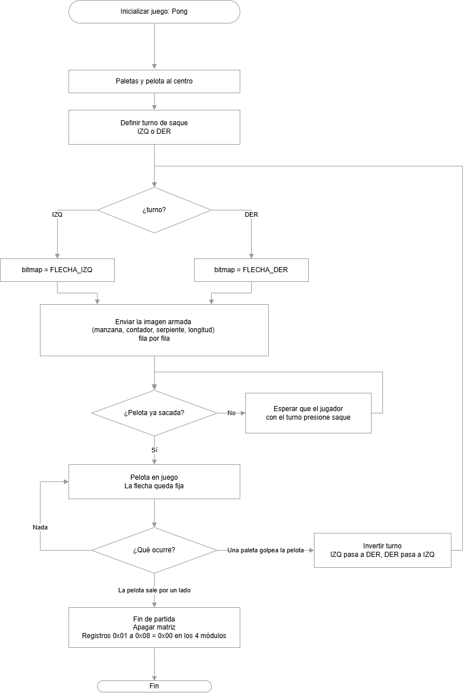
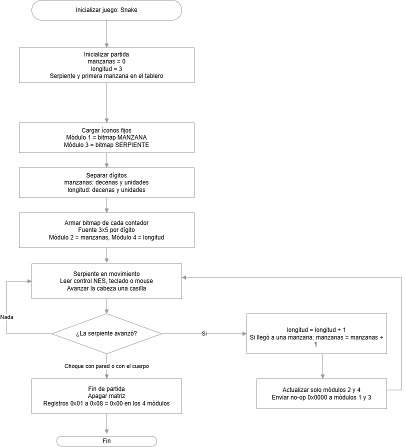

# Diagramas del uso de la matriz MAX7219 en los juegos

Se realizaron diagramas de flujo con ideas para usar la matriz de LEDs MAX7219 (4 módulos de 8×8 en cascada, 32×8 píxeles) como pantalla auxiliar durante los juegos. Los puntajes no se muestran en esta matriz porque ya los cubre otra pantalla.

## Pong

La matriz muestra una flecha que apunta al jugador que debe golpear la pelota. Se redibuja solo cuando cambia el turno: en cada saque y cada vez que una paleta devuelve la pelota.

## Snake

La matriz se divide en cuatro módulos, de izquierda a derecha: manzana fija, manzanas recogidas, serpiente fija y longitud de la serpiente.

## Batalla naval

Se realizó un diagrama que define las acciones que realiza nuestro módulo desde la preparación hasta el fin del juego. El objetivo es que la matriz pueda mostrar el histórico de lanzamientos de cada jugador, para que no repitan jugadas erróneas.

## Galaga

Se realizó un diagrama en el que la matriz muestra la cantidad de naves (vidas) de cada jugador y el stage en el que se encuentran. Se supone que el juego es infinito y solo termina cuando el jugador muere, es decir, cuando es impactado 3 veces.

